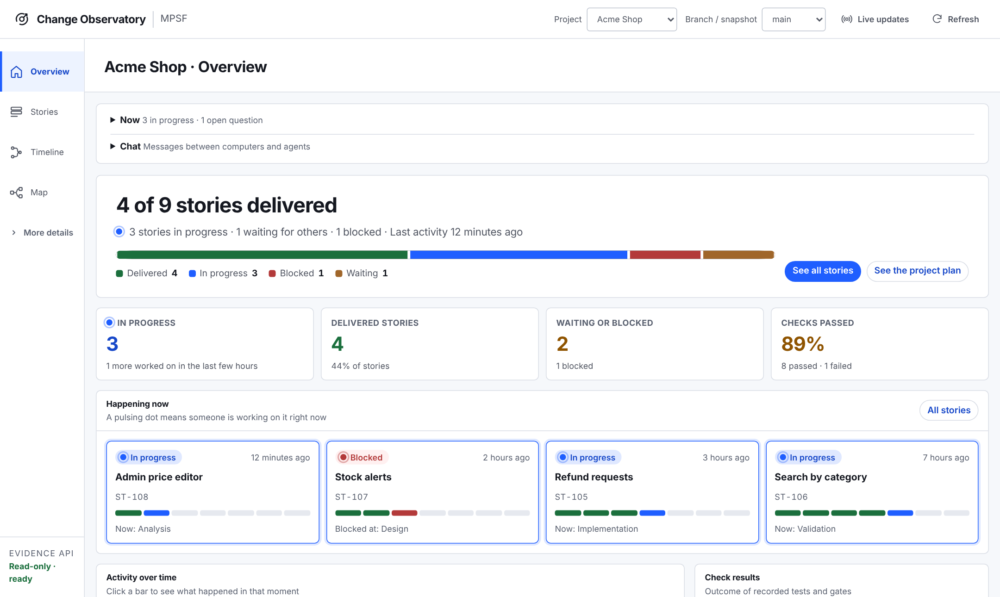
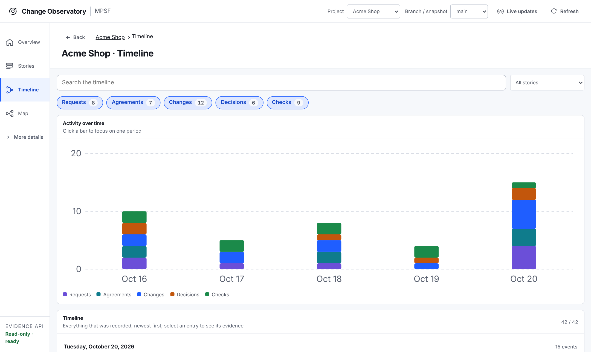
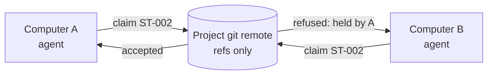
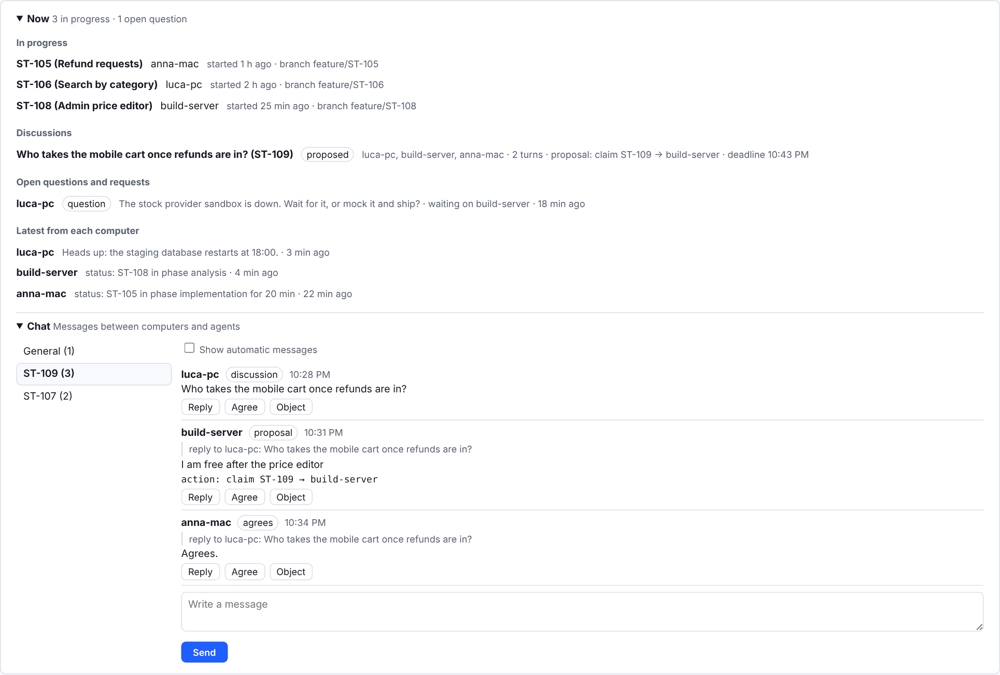

<p align="center">
  <picture>
    <source media="(prefers-color-scheme: dark)" srcset="assets/brand/logo-dark.svg">
    
  </picture>
</p>

<h3 align="center">Your coding agent wrote the code. Can you show what it was asked, what it was allowed to touch, and what it actually tested?</h3>

<p align="center">
  MPSF (<b>My Personal Software Factory</b>) is a free plugin for <b>Claude Code</b> and <b>OpenAI Codex</b> that turns agent work into a reviewable, verifiable record kept in your own git repository.<br>
  No server, no account, no telemetry: records stay in your repository.
</p>

<p align="center">
  <a href="https://github.com/aantenore/mpsf/actions/workflows/ci.yml"></a>
  <a href="https://github.com/aantenore/mpsf/releases/latest"></a>
  <a href="LICENSE"></a>
  
  
</p>

<p align="center">
  <a href="#try-it-in-two-minutes">Try it</a> ·
  <a href="#why-it-is-different">Why it is different</a> ·
  <a href="#several-computers-no-server">Several computers</a> ·
  <a href="#how-it-compares">How it compares</a> ·
  <a href="docs/README.md">Docs</a>
</p>

---

Agents are fast. The problem is everything around the diff: a chat that scrolls away, an assumption nobody confirmed, a file outside the agreed scope, a "tests pass" that was never run. Code review sees the result, not the reasoning or the boundary.

MPSF puts a contract around each piece of agent work:

1. **Agree first.** The agent states what it understood about the project and proposes a plain-language work brief: goal, files, tools, limits, exclusions. You approve it once.
2. **Work inside the boundary.** A deterministic CLI, not the model, checks the work against what you approved. Changed files outside the agreed paths, actions outside the approved set and exhausted budgets stop the delivery.
3. **Prove it.** Tests are recorded with the exact command, exit status and output. "Done" means the gate passed on recorded evidence, not that the agent said so.
4. **Keep it.** Requests, decisions, changes and checks live under `.sdlc/` in your repository, travel with the code, and open in a local visual app.

<p align="center">
  
  <br><sub>Change Observatory, the bundled local app (sample data). It runs on 127.0.0.1 and never edits your code or your records.</sub>
</p>

## Try it in two minutes

Requires **Node.js 18.20.3–18.x, 20.12.0–20.x, or 21.6.0+** and Git.

### Claude Code

```bash
/plugin marketplace add aantenore/mpsf
/plugin install mpsf@aantenore
/mpsf:doctor
```

Full guide: [Claude Code Installation](docs/hosts/claude-code.md).

### Codex

Codex installs from a checkout through a transactional installer (check, plan, apply, validate, with a byte-exact restore if anything fails):

```bash
git clone https://github.com/aantenore/mpsf.git
cd mpsf
python3 scripts/install-personal-marketplace-v2.py check
```

Then follow [Codex install](docs/hosts/codex.md#install) for the remaining steps.

### First run, in a throwaway folder

```bash
mkdir mpsf-trial && cd mpsf-trial && git init
```

This local-only trial runs a sandboxed smoke test: built in on macOS and Windows 10 1809+, while Linux needs bubblewrap at `/usr/bin/bwrap` (`sudo apt install bubblewrap` or your distribution's package).

Open the folder in a new agent session and ask:

```text
Initialize MPSF in this project with the default workflow.
```

Then:

```text
Build and verify this result only on my local machine. Do not push, open a pull request, deploy, or use production.
Implement a configurable trip-policy module that rejects trips above a cost limit, with tests.
```

The agent proposes a requirement and a work brief and waits for your approval before writing code. When it finishes, run `/mpsf:observe` (or ask it to open the Change Observatory) to see the request, the decisions, the changed files and the recorded tests. Delete the folder to remove everything.

On a real project, start with the request that matches the outcome and add your requirement, PR link or limits after it:

| Goal | Ask the agent | Claude Code shortcut |
| --- | --- | --- |
| Understand an existing codebase | `Contextualize this project and prepare an initial technical assessment.` | `/mpsf:assess` |
| Requirement to a new pull request | `Turn this new requirement into an agreed work brief, implement it, verify it, and open a new pull request.` | `/mpsf:deliver` |
| Finish a pull request that already exists | `Continue this existing pull request, verify the requested changes, and update the PR without creating a new one.` | `/mpsf:continue-pr` |
| Build and verify only on this machine | `Build and verify this result only on my local machine. Do not push, open a pull request, deploy, or use production.` | `/mpsf:local` |

Full walk-through: [Getting started](docs/getting-started.md). To run the `mpsf …` commands shown in the docs from your own terminal, see [Run the CLI from your terminal](docs/hosts/claude-code.md#run-the-cli-from-your-terminal).

## Why it is different

| | What MPSF does | Where to check |
| --- | --- | --- |
| **The model is not the referee** | Requirements, work briefs, permissions, budgets and evidence are validated by a deterministic Node.js CLI against JSON schemas. The conversation proposes; the CLI decides what is allowed. | [Architecture](docs/architecture.md) |
| **Autonomy is chosen per delivery** | For each pull request or local release you pick how independent the agent is: ask at every step, continue between checkpoints, or finish inside the shown limits. Merge, production, deploy and force-push are never implied. | [How it works](docs/how-it-works.md) |
| **Evidence, not claims** | `test record` binds a story to the exact command and exit status. The lifecycle gate passes only when requirement, contract, outputs, latest tests and release evidence agree. Changed files are scanned for committed credentials. | [Commands](skills/agentic-sdlc/references/commands.md) |
| **History you can check** | The local trace is hash-linked to a checkpoint, so edits, reordering and truncation are detected by `mpsf trace verify`. That is tamper-evident, and the docs say plainly it is not tamper-proof. | [Self-service CLI](docs/self-service-cli.md#verify-the-project-history) |
| **Records live in your repo** | Everything is plain files under `.sdlc/` (or an `sdlc-state` branch). Another person or agent can pick up the work months later without the original chat. | [Knowledge-base structure](docs/kb-structure.md) |
| **Readable by non-engineers** | The Change Observatory answers "what was asked, what changed, why was it decided" for each story, down to the raw record. English and Italian UI. | [Change Observatory](docs/change-observatory.md) |
| **Two hosts, one tree** | Claude Code and Codex load the same skills, schemas, templates and CLI. | [Hosts](docs/hosts/README.md) |
| **Windows included** | The local-release smoke test runs in a sandbox on all three systems: built in on macOS, bubblewrap on Linux, a per-run AppContainer on Windows 10 1809+ with no admin rights. | [Windows](docs/windows.md) |

Want to see two of these checks fail on purpose before installing anything else? [See it catch problems in one minute](docs/see-it-work.md): edit one word of the history, commit a fake key, and read what the CLI prints.

<p align="center">
  
  <br><sub>Every recorded request, agreement, change, decision and check, filterable by story (sample data).</sub>
</p>

## Several computers, no server

Run agents on several machines against the same project and coordinate them through the git remote you already have.



- **Atomic story claims.** `story claim` records the claim on the remote with a push that only the first claimer wins. The other computer is told who holds the story, on which branch and since when.
- **Signed messages between computers.** The default channel is one git ref per computer; each message is a small commit signed with that computer's Ed25519 key. Unregistered or wrong signatures are shown as untrusted. Messages only inform; they never approve or claim anything.
- **Agent discussions with a binding outcome.** When two agents disagree (who takes a half-finished story, for example) they can open a short, time-boxed discussion. Only a signed, schema-valid decision binds, and it maps to an existing command that still runs all its checks. An unresolved objection goes to a person.
- **Optional coordinator role.** One computer can hold a lease to merge pull requests one at a time, publish records, free abandoned claims and keep the base branch green.
- **Any git server.** Claims, the channel, signatures and discussions work on GitHub, GitLab, Gitea/Forgejo, Bitbucket or a bare git remote. Coordinator merges use the GitHub, GitLab and Gitea/Forgejo APIs.
- **Mixed plugin versions.** A record that needs a newer plugin declares it; an older install keeps read-only commands working and refuses changes until it is updated.

<p align="center">
  
  <br><sub>Three computers on one project: who holds which story, an open question, and a discussion that ends in a proposed claim (sample data).</sub>
</p>

Details: [Messages between computers](docs/messaging.md), [Adapters and roles](docs/adapters-and-roles.md), [Parallel work](docs/architecture.md#several-computers).

## How it compares

MPSF does not replace your agent, your tests or your CI. It adds the agreement and the record around them.

| | Plain agent session | Rules file (`CLAUDE.md`, `AGENTS.md`) | Spec-driven kit (e.g. [Spec Kit](https://github.com/github/spec-kit)) | CI checks | **MPSF** |
| --- | :---: | :---: | :---: | :---: | :---: |
| Scope agreed before the agent writes code | | partly | ✔ | | ✔ |
| Scope enforced outside the model | | | | | ✔ |
| Agent autonomy chosen per delivery | | | | | ✔ |
| Tests tied to the exact command and exit status that ran | | | | ✔ | ✔ |
| Why a decision was taken, kept with the code | | | partly | | ✔ |
| Visual history a product owner can read | | | | | ✔ |
| Several computers coordinated without a server | | | | | ✔ |

A spec-driven kit gives the agent better instructions: spec, plan and task files it reads before coding. MPSF checks the result against what you approved, with a deterministic CLI instead of the model's word. The two fit together: the agent can turn a spec into the requirement you approve.

## Who it is for

- **Developers using Claude Code or Codex** on real repositories, who want to hand over bigger tasks without losing control of scope.
- **Software houses** that have to show a client what was asked, decided, changed and verified for each delivery.
- **Teams in regulated environments** that need a change trail they can audit. MPSF keeps evidence; it does not certify compliance on its own.

## Questions people ask first

**Do I have to learn the CLI?** No. You talk to the agent as usual; the skills load when the conversation matches, and the slash commands are only shortcuts. A few steps are reserved for you in your own terminal, such as approving a standing approval; the agent hands you the exact command.

**Can the agent get around it?** Partly, and the docs say where. The hooks and the CLI refuse the obvious paths, but in the default mode an agent that writes and runs its own script could still approve a standing approval. Projects that need more turn on [signed approvals](docs/how-it-works.md#signed-standing-approvals), where only the host's Ed25519 receipt counts.

**What does it cost my session?** Each hook check adds a short Node start-up to shell and edit calls, and hook output is capped per event (700 tokens at session start, a few hundred elsewhere). Agents read small per-story [context packs](docs/token-efficiency.md#context-packs-and-compact-output) instead of whole records.

**What if I stop using it?** `/plugin uninstall mpsf@aantenore`. The records stay in `.sdlc/` as plain files (JSON, JSONL, Markdown) in your repository, readable without the plugin.

## Documentation

| Start | Go deeper | Reference |
| --- | --- | --- |
| [Getting started](docs/getting-started.md) | [How it works](docs/how-it-works.md) | [Command reference](skills/agentic-sdlc/references/commands.md) |
| [Claude Code](docs/hosts/claude-code.md) · [Codex](docs/hosts/codex.md) | [Limits and metering](docs/limits-and-metering.md) | [Architecture](docs/architecture.md) |
| [Change Observatory](docs/change-observatory.md) | [Configurable workflows](docs/configurable-workflows.md) | [Reference overview](docs/reference.md) |
| [Windows](docs/windows.md) | [Messages between computers](docs/messaging.md) | [All guides](docs/README.md) |

## What's new

- **1.0.24** — state-file helper through the runtime host (CI fix).
- **1.0.23** — Change Observatory: a new project opens on the steps to its first story.
- **1.0.22** — Change Observatory: each record view opens with its own record in the inspector.
- **1.0.21** — Change Observatory: project plan fits the page; mobile toolbar fix.
- **1.0.20** — README answers the first questions newcomers ask.
- **1.0.19** — Change Observatory: checks show Passed or Failed; Italian fixes.
- **1.0.18** — `/mpsf:doctor` tells a new user what to do next.
- **1.0.17** — guard refuses switching the plugin off in host settings; lighter PreToolUse.
- **1.0.16** — machine key self-repairs; state pushes retry only on a moved tip.
- **1.0.15** — README shows the Observatory chat across computers.
- **1.0.14** — git channel: lock never taken from a live holder; refused pending pushes recover on their own.
- **1.0.13** — README compares MPSF with spec-driven kits.
- **1.0.12** — Change Observatory: sample-project screenshots, Now and Chat documented, clearer chat.
- **1.0.11** — new page: [see it catch problems in one minute](docs/see-it-work.md).
- **1.0.10** — local state files written atomically: parallel hooks no longer lose state.
- **1.0.9** — Stop hook stays within its time limit; long `run` timeouts no longer fire at once.
- **1.0.8** — guard: follows the targeted project from any folder; comments and CRLF cannot hide commands.
- **1.0.7** — CLI messages use the `mpsf:` prefix.
- **1.0.6** — Change Observatory: dark theme that follows your system setting.
- **1.0.5** — Windows edge cases: `.exe` smoke commands, case-insensitive protected folders, BOM in presets.
- **1.0.4** — Change Observatory: Now panel on the Overview only, chat keeps focus while you type.
- **1.0.3** — coordination: no claim freed on unreadable presence, presence checked against its ref name, clock-skew fix.
- **1.0.2** — robustness: session context back after `/clear` and `/compact`, race-free command lock, stricter record validation.
- **1.0.1** — first run: clearer `doctor` next step, plugin folder shown, `mpsf` alias guide, Linux sandbox note.
- **1.0.0** — first stable release: new README and logo, Change Observatory screenshots, the full overview in [docs/reference.md](docs/reference.md). Same behaviour as 0.164.x.
- **0.164.x** — agent discussions: a settled outcome stays settled, a person can decide from any computer, and the Observatory redacts discussion text.
- **0.164.0** — Change Observatory: write in the chat, reply, agree or object to a discussion.
- **0.163.0** — Change Observatory: chat view of the project channel, one room per story.
- **0.160–0.162** — discussions between agents, where only a signed decision binds.
- **0.159.x** — Windows back in CI; fast test tier in a few minutes per cell.

Everything else is in the [changelog](CHANGELOG.md).

## Contributing

Issues and pull requests are welcome. Iterate with `npm run test:fast`; run `npm test` before a pull request. Bump versions with `npm run sync-version`.

## License

[MIT](LICENSE) © Antonio Antenore
