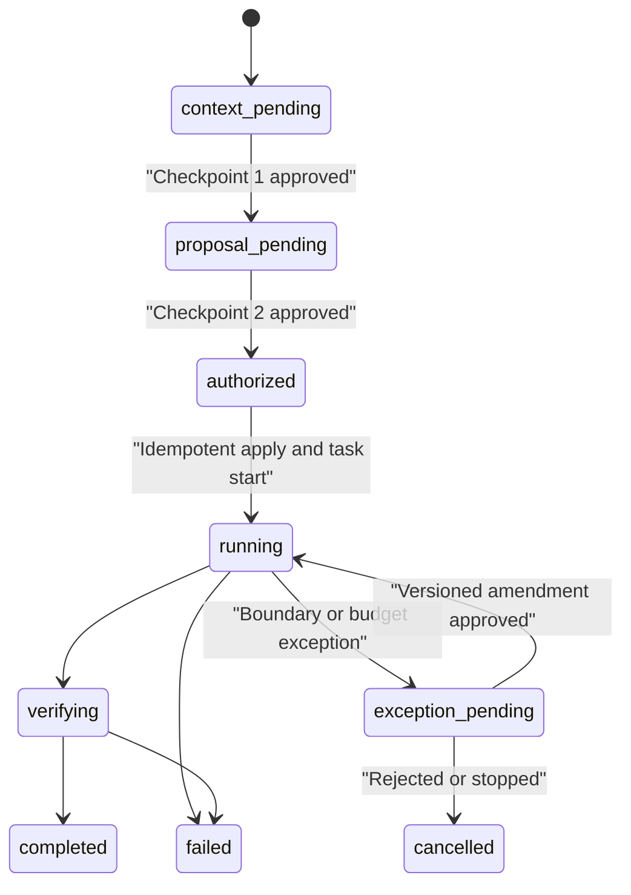

# Assessment Interactions

This document defines the user-facing behavior of the `Project Assessment` skill. The product asks for two business decisions and keeps SDLC bookkeeping behind them.

## Activation

The first starter prompt is:

```text
Contextualize this project and prepare an initial technical assessment.
```

Equivalent requests in any language select the same journey, including “Contestualizza il progetto e prepara un assessment tecnico”, “Assess the architecture and risks”, and requests for Word, Excel, PDF, PowerPoint, HTML, JSON, CSV, or Markdown delivery.

Preserve any root, format, destination, exclusions, evidence sources, autonomy boundary, or budget already provided. Do not ask twice for the same unchanged, hash-bound choice. A new pull request or local release is a new delivery unit and must always receive its own explicit autonomy selection.

## Exactly Two Normal Checkpoints

The normal local assessment always has these two logical checkpoints:

1. project context;
2. immutable combined proposal and complete execution tranche.

There is no separate normal decision for requirement, story, capabilities, template, contract, start, verification, or budget when all are visible inside the immutable bundle. The assessment proposal carries no delivery profile. Delivering the result as a pull request or local release is a separate delivery with its own autonomy choice (`autonomy delivery propose`). A fresh approved context may make checkpoint 1 short, but it remains correctable when the user requested contextualization.

An additional decision is required for a different delivery unit, material requirement or delivery drift, protected-branch merge, remote deployment, install, external access, secret, production access, destructive action, out-of-scope write, material proposal change, or unapproved budget extension.



## Contract For Every Question

Every question shown to the user—including a clarification, exception, or budget-extension request—must include:

- what is being asked;
- why it is required now;
- what the response authorizes;
- what it does not authorize;
- valid answer examples in Italian and English.

A bare “Proceed?” or “Approve?” is invalid. When `authority_policy.mode` is `host_verified`, the host or CI system issues an Ed25519-signed `host-approval-receipt:v2` for the direct answer, passed with `--host-receipt-file`. In the default `audit_only` mode the CLI records the declared attribution with `audit_only` assurance. An agent cannot create authority by declaring itself a human actor.

Open questions use the configurable `open_question_guidance` policy. It classifies questions as objective, users/stakeholders, constraints/NFRs, output/delivery, integrations, approval boundaries, or budget/time; each category supplies keywords, why the answer matters, Italian and English examples, and the exact proposal effect. An unmatched question uses the configured fallback. The original question is always the “what”; guidance must not replace it with an internal category label.

Assessment routing is also data-driven. `assessment_workflow.requested_actions` lists the normalized actions that must enter the baseline-plus-combined-proposal journey. Adding an action there changes routing policy without changing CLI code; it must never be used to bypass either logical checkpoint.

## Checkpoint 1 — Project Context

Inspect the repository and user-provided local files read-only. Explain:

- evidenced product purpose, users, and lifecycle state;
- stack, runtime, deployment model, integrations, boundaries, and components;
- exact evidence inspected;
- constraints and non-goals;
- observed facts versus inferences;
- assumptions, contradictions, confidence, open questions, and facts that cannot be recovered.

Paths are supporting evidence, not the explanation.

### Required question

- **What is being asked:** approve or correct only the displayed project context.
- **Why:** the assessment needs a canonical baseline and cannot convert inference into fact silently.
- **Authorizes:** approval of the represented baseline content hash.
- **Does not authorize:** assessment scope, requirement/story creation, format, tools, writes, external access, budget, contract, or start.
- **Question:** “Do you approve this context, or what should I correct?”
- **Italian examples:** “Approvo il contesto”; “Correggi: usiamo Kubernetes, non ECS.”
- **English examples:** “I approve the context”; “Correct this: we use Kubernetes, not ECS.”

Apply corrections inside this same checkpoint. Internally use `onboard existing-project` and `baseline approve`. If the person has granted a `baseline.approve` delegation (`autonomy delegation grant --actions baseline.approve`), the agent may record this approval with `--approval-source delegated --delegation <DLG-id>`. Only the person creates the delegation, never the agent. Checkpoint 2 cannot be delegated: `assessment proposal approve` accepts only explicit-user or CI. The baseline approval must never be reused as checkpoint 2 approval.

## Prepare The Immutable Proposal

After checkpoint 1, run `assessment proposal prepare`. It creates:

- an `assessment-proposal:v1` in `proposal_pending` state;
- an `assessment-workflow:v1` resumable state record;
- a complete `execution-budget:v1`;
- stable reservations for requirement, story, template, contract, output, and receipts. The authorization ID is not reserved here; it is derived when the proposal is approved.

The proposal binds `baseline_ref.approved_content_hash` and hashes the complete approval payload with `proposal_hash`. It includes:

- scope ID/title/summary and real requirement ID;
- story reservation and acceptance criteria;
- artifact type, preset, sections, canonical delivery, generator, verifier, and destination;
- capabilities, permissions, targets, and evidence plan;
- contract draft and route intent;
- exact `write_set[]` actions, subject IDs/hashes, paths, and artifact types;
- execution budget and stop policy;
- security boundaries, approval boundary, and idempotent application plan.

The system may not fill in material content after approval. Changing any bound field creates a new proposal hash and requires checkpoint 2 again.

## Checkpoint 2 — Combined Proposal And Complete Tranche

Use five primary blocks:

1. **Outcome, scope, evidence** — supported decision, audience, inclusions/exclusions, depth, requirement/story, reuse mode, sources, and checks.
2. **Deliverable, verification** — sections, format, extension, media type, path, delivery mode, generator, verifier, and required verification dimensions.
3. **Tools, security, writes** — installed capabilities, permissions, targets, full write-set, and excluded risky operations.
4. **Budget and stop policy** — the complete execution tranche.
5. **Start and boundary** — internal records/actions, task start, final delivery, exception triggers, and exclusions.

Put proposal/baseline hashes, requirement/story/template/contract IDs, subject hashes, authorization actions, artifact types, and idempotency key in a compact technical appendix. It may be collapsible, but not hidden from the decision.

### Budget in the same checkpoint

Show concrete values and metering accuracy/source for:

- target active time, excluding user and approved external waiting; the default is an estimated soft limit of 2,700 seconds with no hard limit;
- aggregate main-agent and subagent steps; the default is an estimated soft limit of 40 with no hard limit;
- aggregate main-agent and subagent tokens; the default is an estimated soft threshold of 200,000 with no hard limit;
- cost/currency only when both a reliable metering/pricing adapter and a currency are configured;
- configured warnings, normally 70% and 90%;
- completion and verification reserve, normally 15%;
- action at limit: request extension, partial delivery, or stop;
- automatic extension: none; a limit never raises itself, and every extension needs a separate explicit `budget amend` decision.

Label every metric `exact`, `estimated`, or `unavailable`. Estimated or unavailable limits cannot be presented as hard enforcement. In particular, when no trustworthy pricing adapter, pricing reference, or currency is available, checkpoint 2 must label cost `unavailable` and non-binding; it must not invent or imply a cost cap. The tranche includes analysis, generation, verification, linking, gates, receipts, and final delivery.

### Required question

- **What is being asked:** approve the exact proposal ID/hash and complete tranche, or request a change.
- **Why:** one decision can replace fragmented approvals only when every authorized subject, write, tool, verification step, and budget limit is fixed and visible.
- **Authorizes:** only the displayed requirement/story, exact subject hashes and write-set, proposal-bound automation uses, task start, analysis, artifact, layered verification, KB linking, budget policy, and final summary.
- **Does not authorize:** another PR or local release; protected-branch merge; remote deployment; installs; undisplayed external/production access; secrets; destructive actions; different subjects, paths, or artifacts; material changes; or budget extensions.
- **Question:** “Do you approve proposal `<id>` at hash `<hash>`, including this budget and stop policy, or what should I change?”
- **Italian examples:** “Approvo la proposta `<id>` con questo budget”; “Modifica: massimo 45 minuti, nessuna fonte esterna, DOCX.”
- **English examples:** “I approve proposal `<id>` with this budget”; “Change it: 45 minutes maximum, no external sources, DOCX.”

One short approval covers only the visible hash-bound bundle. It does not approve the eventual findings themselves.

## Internal Command Choreography

The supported assessment lifecycle is:

```text
onboard existing-project
baseline approve
assessment proposal prepare
assessment proposal approve
assessment proposal apply
budget meter start
assessment proposal status
budget meter record
budget usage record
budget status
assessment proposal complete
```

Supporting commands are `requirement status`, the only requirement command used in the assessment journey; for an approved exceptional change `budget amend`; and, when the person decides to stop at an exception (with or without a partial result), `assessment proposal cancel`. `requirement propose|approve|revise|supersede` belong to the separate `requirement:v2` lifecycle. `requirement create` remains only a compatibility alias for proposal creation; it must not bypass approval.

- `assessment proposal approve` validates the unchanged proposal hash, records the host approval, and creates a proposal-bound content authorization.
- `assessment proposal apply` applies the displayed write-set idempotently. A partial failure is resumed through workflow state, not a new normal checkpoint.
- `budget meter start|record` captures usage from the configured meter adapter. Use `budget usage record` only for usage measured outside a meter.
- Every automation approval and task start writes an immutable usage receipt with the authorization snapshot and `valid_at_use`. Canonical assessment authorization uses `authorization-usage-receipt:v2`; the compatibility CLI uses pair-bound `authorization-usage-receipt:legacy-v2`. Later closure or revocation does not invalidate historically valid uses.
- `assessment proposal complete` is internal and succeeds only after required output, verification, linkage, usage accounting, and gates. It is not a third decision.

## Requirement And Story Lineage

The assessment creates one approved requirement record, such as `REQ-INITIAL-ASSESSMENT`, and one story, such as `ST-INITIAL-ASSESSMENT`. The requirement uses `requirement:v1` and is bound to the proposal through `proposal_ref`. The assessment creates no execution or autonomy profiles. Every example and record must use those same IDs consistently:

```text
Proposal: INITIAL-ASSESSMENT
Requirement: REQ-INITIAL-ASSESSMENT
Story: ST-INITIAL-ASSESSMENT
Template: technical-analysis-assessment-v1
Contract: contract-ST-INITIAL-ASSESSMENT-analysis
Authorization: AUTH-INITIAL-ASSESSMENT-<first 8 hex of proposal_hash>, created at approval
Release: RELEASE-INITIAL-ASSESSMENT
```

`assessment proposal apply` creates the requirement and story; inspect them with `requirement status`. Do not pre-create the reserved requirement or story IDs: apply refuses an ID that already exists outside the proposal, and only an idempotent replay of the same proposal reuses records. Never write a fake `REQ-001` merely to satisfy output linking. A later pull request or local release from this work needs a `requirement:v2` revision with its own delivery profile, set up outside the assessment journey.

## Delivery Autonomy Choice

The requirement records only the greatest freedom that may be offered; it does not authorize execution. Before each delivery begins, ask the user to choose in plain language for that one delivery:

1. **Ask before every important step.**
2. **Work between the agreed review moments.**
3. **Finish this delivery within the displayed limits.**

Never lead with internal level names. Show the recommendation, why it fits, and what would make a safer choice preferable. Then show the exact delivery boundary:

- For a pull request, show repository, source and destination branches, allowed actions and files, the one approved requirement contract, exclusions, and whether merge is included.
- For a local release, show the local destination, allowed actions and files, smoke checks, the one approved requirement contract, restoration procedure, and the explicit exclusion of remote, production, and destructive access.

Use requirement clarity, testability, reversibility, environment, data/security impact, known tools, write paths, and budget to explain the recommendation. Prior successful runs may inform it but never grant more freedom. If any project, requirement, contract, tool, environment, or budget rule is stricter than the user’s choice, explain the practical reduction in ordinary language.

The choice applies to one PR or local release and exactly one approved requirement contract. It cannot be reused, permits at most one concurrent run, and closes when that delivery finishes. Merging to `main` or another protected branch and every remote or production deployment remain separate unless the displayed boundary explicitly includes them.

After the user-facing choice, optional technical details may show the stored mapping: `supervised`, `checkpointed`, or `bounded-autonomous`. The strongest mapping requires an external host/CI Ed25519 proof for that exact approval; without it, execution is reduced to work between agreed review moments. The internal assurance names `audit_only` and `host_verified`, profile IDs, hashes, and receipt paths belong only after the technical divider.

The only exception is a **standing approval** the user gave earlier for repeated low-risk work, such as dependency bumps or retired-flag cleanup. When one covers the delivery, the agent skips these questions and the per-action confirmations, and stops to ask the moment any step falls outside its paths, size, destination, delivery count, expiry, budget, or the project rules it was approved under, or after it is revoked. Offer a standing approval only for repetitive toil, phrase it with its exact limits in plain language, and record it only after the user explicitly agrees; the agent never creates or widens one on its own. Where approvals must be signed, the user's approval also needs the trusted host's signed receipt for that exact standing approval, which the agent never creates or signs. Merge, production, deploys, and data migrations are never covered.

For delivery work, reserve the planned delivery-record ID in the requirement-bound story contract and approve the contract first. Then bind the delivery record to the immutable requirement, story, and contract hashes. Task start rejects drift; do not rewrite the approved contract to create a circular reference.

After start, explain the action lifecycle as **approve the exact action → execute it → record what happened**. Approval evidence does not itself run Git or call a provider. A local release runs only the approved smoke commands in a read-only, no-network sandbox: macOS `/usr/bin/sandbox-exec` (loopback denied, so listener-based smoke checks are unsupported) or Linux `/usr/bin/bwrap --unshare-net` (listeners stay inside the isolated namespace; on Windows, run the CLI inside WSL2). If neither is available, a local release cannot be proposed; offer a pull request instead. Push or merge first records the live remote state and completion checks the exact Git remote or GitHub pull request afterward. Preserve durable host, CI, or provider evidence when available; internal action names and signed-subject details remain optional technical information.

## Proposal-Bound Authorization

New assessments use `content-authorization:v2`, not a free-text grant alone. Requirement and delivery profiles constrain what may be derived but are not executable credentials. The authorization contains:

- exact proposal ID/hash;
- canonical `allowed_uses` bindings for each exact action + subject-content hash pair, plus derived action/subject indexes;
- bounded use policy and terminal closure rule;
- host or CI authority assurance;
- validity window and immutable authorization hash.

A delivery profile is not part of the content authorization; it is bound by the task-start and delivery-start receipts.

Empty arrays are not wildcards. Legacy v1 snapshots with multiple actions and multiple subjects are ambiguous and fail closed; only v1 snapshots with one action or one subject can be mapped safely. Each use is evaluated at its own timestamp and persisted as an `authorization-usage-receipt:v2` before the authorized mutation.

For direct `authorization grant` usage outside the assessment proposal, declare repeated `--allow-use action=subject` values whenever both dimensions are plural. `--allow-action` plus `--allow-subject` remains compatible only when one side has a single value, so it cannot silently grant the cross-product of two independent lists.

`host_verified` requires a signed `host-approval-receipt:v2` (with `attestation`): the host signs the canonical unsigned payload hash with Ed25519, and `attestation.key_id` must resolve to exactly one public key in `authority_policy.trusted_host_keys`. The signed question contract must name what is and is not authorized, and `constraints.subject_hash` must equal the approved subject hash. Missing trust roots, signatures, question fields, or subject-bound constraints fail closed and remain `audit_only`.

## Budget Monitoring And Amendment

Warnings are non-blocking progress updates. Before exceeding a non-automatic limit, ask one exception question using the full question contract. Show remaining budget, accuracy, completed/remaining work, requested increment/new total, reason, and partial-delivery alternative.

- **Authorizes:** only the displayed budget delta.
- **Does not authorize:** wider scope, tools, access, paths, or subjects.
- **Italian examples:** “Approvo altri 20 minuti, totale 60”; “Consegna parziale senza estensione.”
- **English examples:** “Approve 20 more minutes, 60 total”; “Deliver the partial result without extending.”

`budget amend` creates `budget-amendment:v1` against the base budget/proposal hashes. Never mutate the approved base budget. `budget usage record` persists actual/estimated values, reservations, source, and accuracy; the final response reports them honestly.

## Canonical Formats

| Canonical format | Aliases | Extension | Media type | Generator/verifier |
| --- | --- | --- | --- | --- |
| `markdown` | `md`, `markdown` | `.md` | `text/markdown` | native checks |
| `docx` | `word`, `doc`, `docx` | `.docx` | `application/vnd.openxmlformats-officedocument.wordprocessingml.document` | `documents` |
| `xlsx` | `excel`, `spreadsheet`, `workbook`, `xlsx` | `.xlsx` | `application/vnd.openxmlformats-officedocument.spreadsheetml.sheet` | `spreadsheets` |
| `pdf` | `pdf` | `.pdf` | `application/pdf` | `pdf` |
| `pptx` | `powerpoint`, `slides`, `pptx` | `.pptx` | `application/vnd.openxmlformats-officedocument.presentationml.presentation` | `presentations` |
| `html` | `html` | `.html` | `text/html` | native generation plus browser rendering |
| `json` | `json` | `.json` | `application/json` | native schema/syntax checks |
| `csv` | `csv` | `.csv` | `text/csv` | `spreadsheets` |

Use `artifact` or `artifact-plus-chat-summary`, defaulting to the latter. Never fake a format by changing an extension.

## Generation Receipt And Layered Verification

The format capability emits `artifact-generator-receipt:v1` for the exact artifact. Pass it separately from render evidence:

```bash
node <plugin-root>/bin/mpsf.mjs output link \
  --root <target-project> \
  --story ST-INITIAL-ASSESSMENT \
  --type technical-analysis \
  --artifact docs/technical-assessment.docx \
  --template technical-analysis-assessment-v1 \
  --mode new \
  --requirement REQ-INITIAL-ASSESSMENT \
  --authorization <authorization-id-from-assessment-proposal-approve> \
  --receipt-file .sdlc/receipts/generation/GEN-ST-INITIAL-ASSESSMENT.json \
  --render-evidence .sdlc/tests/ST-INITIAL-ASSESSMENT-docx-render.png
```

`--type`, `--template` and `--artifact` must equal the approved proposal's `deliverable.artifact_type`, `template_id` and `artifact_path`, or completion reports the deliverable as not linked. To use this DOCX path, run prepare with `--format docx --artifact docs/technical-assessment.docx`. Without those options, the default path is `.sdlc/stories/<story>/outputs/technical-analysis.<ext>`.

`--authorization` is the exact proposal-bound ID emitted by approval; the link consumes only its `output.link` action/subject pair and stores a use receipt. `--receipt-file` attests which generator produced the exact artifact hash. `--render-evidence` supplies only separate render or visual proof; functional and test evidence belongs in step or trace records. The older `--evidence` spelling remains accepted here as a compatibility alias; neither form substitutes for the generator receipt.

`output link` writes a `verification-receipt:v1` that reports separately:

- `container_verified` — real format/container syntax;
- `content_verified` — required sections, stable IDs, evidence lineage, and semantic checks;
- `render_verified` — pages/sheets/slides/viewports are complete and legible;
- `independent_verified` — currently always `not-required` in receipts written by `output link`; no CLI input records independent verification.

Say “verified” only when all proposal-required dimensions pass. Otherwise qualify the claim. A legacy `status: passed` structural receipt is not evidence of semantic or rendered correctness.

## Work Shared Across Computers

When several computers work on one project, a story belongs to whoever claimed it first on the project's git remote (see [Parallel Work Model](architecture.md#several-computers)). The agent never decides on its own who works on what:

- Before editing, run `orchestrate status --json` and pick only an `available` story. A story `claimed` or `stale` on another computer shows its holder and branch; do not work on it.
- Claim with `story claim` before the first edit. If the claim is refused because the story is held elsewhere (`STORY_CLAIM_HELD_ELSEWHERE`), tell the user who holds it, on which branch, and since when, and offer another available story. Never retry with `--force`.
- If the remote cannot be reached (`STORY_CLAIM_REMOTE_UNAVAILABLE`), nothing was claimed: do not start the work. Offer to retry later. Suggest `orchestration_policy.coordination.mode: local_only` only when the user confirms that the project is worked on from this computer alone.
- Taking over a story held elsewhere is the user's decision (`STORY_CLAIM_TAKEOVER_NEEDS_PERSON`). Show who holds it and since when, and give the user the exact command to run in their own terminal, with their reason: `story claim --id <story> --agent <name> --force --reason "<why>" --actor-type human`.
- When `orchestrate status` or `status` says your claim was taken over, stop working on that story at once and tell the user who took it, when, and why.
- A claim file that arrived with a branch you checked out belongs to the computer that made the claim. Never release or reuse it; releasing or taking over that story from here is the user's decision, with a reason.
- No computer coordinates the others. Each agent claims and reserves only the work it does itself, on its own computer: inside an agent session a worktree holds one claimed story (`STORY_CLAIM_ONE_PER_WORKTREE`) and a computer one reservation (`STORY_RESERVE_ONE_PER_COMPUTER`) until it is finished or released. Never claim, reserve, release, cancel, or supersede a story on behalf of another computer: a story held here can only become work here, and the other computers' agents cannot free it. Assigning work across computers is the user's decision, run in their own terminal. `story cancel` and `story supersede` refuse a story claimed or reserved on another computer until that claim ends.
- Release the claim when the story is complete or handed off. If the release was not shared, say so and run `story release --id <story>` again once the remote is back.

- **Italian examples:** “La story ST-002 è già in lavorazione da bob sul branch feature/ST-002 dalle 9:40: prendo ST-003, che è libera?”; “Il remote non è raggiungibile, quindi non ho assegnato nulla: riprovo tra poco?”
- **English examples:** “ST-002 is already being worked on by bob on branch feature/ST-002 since 9:40: shall I take ST-003, which is free?”; “The remote cannot be reached, so nothing was claimed: shall I retry in a moment?”

## Release And Archive

Completion produces lineage from baseline and proposal through requirement revision/profile, delivery profile, story/contract, authorization uses, artifact generation, layered verification, and execution usage. A pull-request completion does not imply protected-branch merge. A local release additionally requires evidence for its exact local target, smoke tests, and rollback procedure, and does not imply remote deployment. A `release-manifest:v1` inventories those hashes, while `release-gate-receipt:v1` records the deterministic checks that admitted that exact manifest. An `archive-record:v1` is a logical, hash-bound declaration that identified legacy artifacts remain historical but are outside that release scope; it does not move files. The historical `archive closed` command instead emits a distinct `archive_plan` governed by `archive-plan.schema.json`; applying that plan verifies source hashes under a lock and rolls back incomplete moves.

For an existing KB, run an active-only migration as a dry run first:

```bash
mpsf migration active --release-manifest RELEASE-ASSESSMENT-001
mpsf migration active --release-manifest RELEASE-ASSESSMENT-001 --apply
```

The selected release manifest answers the otherwise ambiguous question “what is active?” The command validates every immutable requirement, story, contract, proposal, workflow, receipt, budget, gate, and artifact reference in that manifest. `--apply` requires a pinned project configuration (run `mpsf config migrate` and apply its exact plan hash first, otherwise it refuses without changing anything), never modifies configuration, and does not rewrite those approved records. Evidence belonging only to older valid release manifests is retained in place and bound into an `archive-record:v1`; unfinished work outside both releases is not classified as history.

Use `migration identity` only for an explicit identity-correction request. Preview the declarative source/target mapping first. The command validates legacy and canonical authorization lineage, exact action-subject bindings, revocations, receipts (including all earlier migration receipts), and supported byte references before it plans every dependent hash rewrite. It fails closed for stale supported references, opaque records, and signed or attested evidence affected directly or transitively; that evidence requires reissuance by its original authority. Apply the exact emitted `plan_hash`; a missing or changed hash means the canonical snapshot must be reviewed again. `--apply --plan-hash <preview-plan-hash>` builds and validates the complete result in a same-filesystem shadow tree, including derived state, then activates it through a journaled directory swap and leaves a digest-only receipt under `.sdlc/migrations/identity/`. After an interrupted process, use only `--recover --recovery-nonce <nonce-from-lock> --plan-hash <hash-from-lock>`; recovery is fail-closed, exclusive, and cannot roll back a committed result. This receipt explains the historical transformation without preserving the corrected source email in clear text.

## Completion Message

After `assessment proposal complete`, return:

- verdict and decision implications;
- major risks and prioritized recommendations;
- artifact path and hash;
- exact verification dimensions and evidence;
- budget target/actual, metering accuracy/source, and amendments;
- limitations and open decisions.

Do not add a routine post-delivery approval. The user may request a revision, which either stays inside the approved proposal or becomes a material exception.
